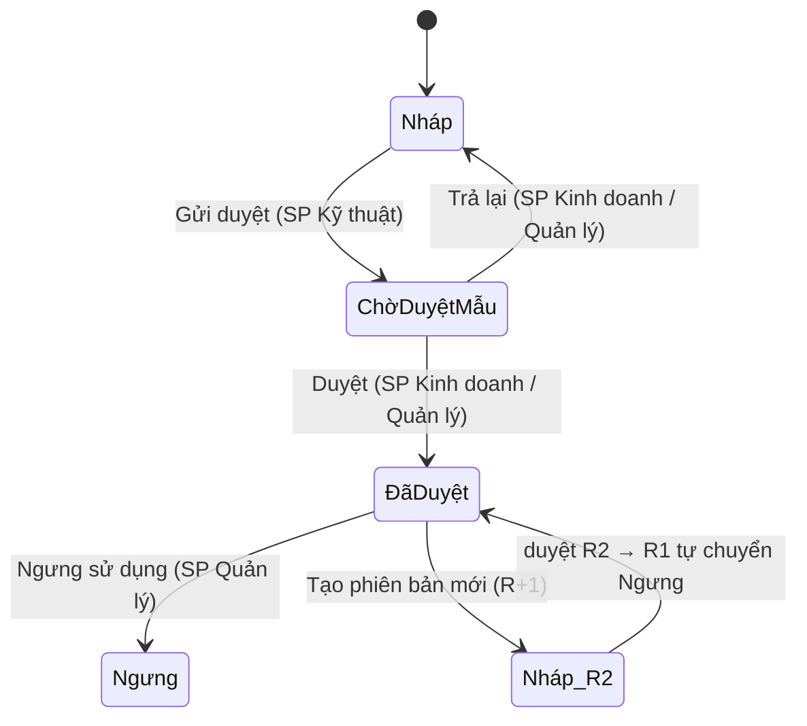

# SP Frappe - Spec Sản phẩm carton

Module **Technical Data Sheet** cho nhà máy thùng carton sóng 3/5/7 lớp (in flexo, offset bồi) trên Frappe/ERPNext.
Mỗi mã hàng có một **Spec** duy nhất: kết cấu giấy, kích thước, khổ phôi, in ấn, công cụ, chất lượng, đóng gói. Spec được duyệt qua workflow, khóa sau khi duyệt, thay đổi bằng phiên bản mới và tự tạo Item ERPNext.

| | |
| --- | --- |
| Nền tảng | Frappe + ERPNext **version-16** (Python 3.14, Node 24, MariaDB 11.8) |
| App | `sp_frappe` (module "SP Frappe"), giấy phép MIT |
| Phiên bản | 0.1.0 - xem [CHANGELOG](CHANGELOG.md) |

## Có gì trong v0.1

- **7 DocType + 3 child table**: SP Product Spec, SP Board Grade (+ Layer), SP Paper, SP Flute, SP Box Style, SP Tooling, SP Settings, SP Spec Color, SP Spec Operation.
- **Tự tính khổ phôi và m²/thùng** (RSC 0201, FOL 0203, MANUAL) theo hệ số bù khổ trong master Loại sóng - không hard-code.
- **Workflow 4 trạng thái**, khóa sửa sau khi duyệt, nút **Tạo phiên bản mới** (R1 → R2, bản cũ tự chuyển Ngưng khi bản mới được duyệt).
- **Tự tạo/cập nhật Item ERPNext** khi duyệt (bật/tắt trong SP Settings); ghi nhận số lần dùng khuôn/bản in.
- 2 báo cáo (`SP Spec Register`, `SP Tooling Life`), 3 Number Card, Workspace "Spec Sản phẩm", mẫu in A4 "Phiếu Kỹ thuật Sản phẩm".
- Dữ liệu demo 10 spec, 77 test tích hợp + 22 test thuần, CI GitHub Actions.

## Cài đặt

Trên bench (đã có ERPNext version-16):

```bash
cd $PATH_TO_YOUR_BENCH
bench get-app https://github.com/khongchibao/sp_frappe --branch main
bench --site <site> install-app sp_frappe
bench --site <site> migrate
```

Frappe Cloud: thêm app từ GitHub repo `khongchibao/sp_frappe`, chọn Bench Group dùng Frappe/ERPNext version-16, cài lên site.

Lệnh `install-app` tự nạp: 4 role, 7 loại sóng, 6 kiểu hộp, UOM `Thùng`, nhóm Item `Products` (nếu chưa có), workflow và SP Settings mặc định.

### Dữ liệu demo

```bash
bench --site <site> execute sp_frappe.demo.make_demo_data
```

Tạo 2 khách hàng giả (`[DEMO] ...`), 6 mã giấy, 4 kết cấu, 3 công cụ, 10 spec (3 và 5 lớp; có/không in; 0201, 0203, DIECUT, 0427, SHEET; đủ ba trạng thái Nháp/Chờ duyệt/Đã duyệt). Chạy lại không tạo trùng.

## Cấu hình sau khi cài

1. **Gán role** cho người dùng: `SP Kỹ thuật`, `SP Kinh doanh`, `SP QC`, `SP Quản lý`.
2. **SP Settings**: bật/tắt `auto_create_item`, chọn `item_group`, `stock_uom`, và danh sách trường bị khóa sau khi duyệt.
3. **Hiệu chỉnh hệ số [GIẢ ĐỊNH]** ở master **SP Flute** (xem bên dưới), rồi bỏ tick "Hệ số giả định - cần xác nhận".

### Chỉnh hệ số khổ phôi

Công thức:

| Công thức | Dài phôi | Rộng phôi |
| --- | --- | --- |
| `RSC_0201` | 2L + 2W + mép dán + bù dài | H + W + bù rộng |
| `FOL_0203` | 2L + 2W + mép dán + bù dài | H + 2W + bù rộng |
| `MANUAL` | nhập tay | nhập tay |

`mép dán`, `bù dài`, `bù rộng` lấy từ SP Flute của spec (mặc định mép dán 35 mm). Giá trị seed đều là **[GIẢ ĐỊNH]**: đo 3 mã hàng thật của xưởng, nếu lệch > 5 mm thì sửa số trong SP Flute (không sửa code). Spec đã duyệt không tự tính lại; spec nháp tính lại khi lưu.

## Luồng trạng thái



Ghi chú: `ChờDuyệtMẫu` = "Chờ duyệt mẫu", `ĐãDuyệt` = "Đã duyệt", `Nháp_R2` = bản nháp phiên bản mới.

## Phát triển

```bash
bench --site <site> set-config allow_tests true
bench --site <site> run-tests --app sp_frappe        # toàn bộ test
python -m pytest sp_frappe/tests/unit -q              # test hàm thuần, không cần bench
python scripts/gen_data_dictionary.py                 # sinh lại docs/DATA_DICTIONARY.md
python scripts/build_print_format.py                  # nhúng template in vào JSON
pre-commit install                                    # ruff + prettier + eslint
```

Tài liệu: [Hướng dẫn sử dụng](docs/USER_GUIDE.md) · [Từ điển dữ liệu](docs/DATA_DICTIONARY.md) · [Quyết định thiết kế](docs/DECISIONS.md) · [CLAUDE.md](CLAUDE.md) (ngữ cảnh cho phiên làm việc tiếp theo).
